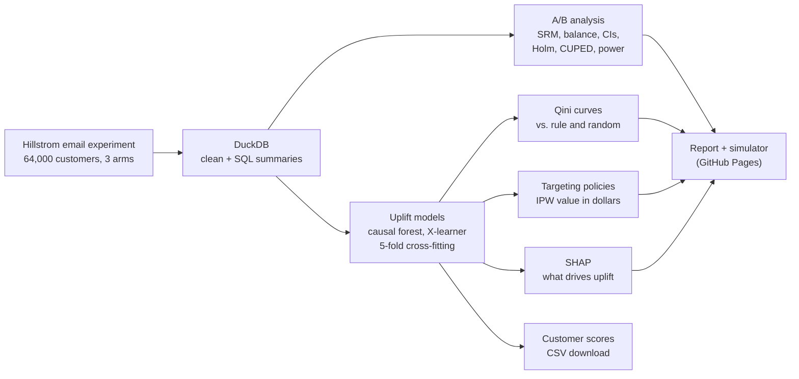

# Email Campaign Experiment: A/B Testing & Uplift Modeling

[](https://github.com/dvskaff/email-campaign-uplift/actions/workflows/ci.yml)
[](https://dvskaff.github.io/email-campaign-uplift/)


* **Report:** [results and the targeting simulator](https://dvskaff.github.io/email-campaign-uplift/)
* **Data:** [every customer with predicted uplift and recommended email (CSV)](https://dvskaff.github.io/email-campaign-uplift/data/customer_uplift_scores.csv)

64,000 customers of an online retailer were randomly split into three groups: one received an email
featuring men's merchandise, one an email featuring women's merchandise, and one received nothing. Visits,
purchases and spend were then tracked for two weeks.

This project answers three business questions:

1. **Did the emails work?** A/B test analysis with sample-ratio and balance checks, confidence intervals,
   multiple-testing correction, CUPED and regression-adjusted variance reduction, and power analysis.
2. **Who responds to which email?** Uplift (heterogeneous treatment effect) models: EconML causal forests
   and X-learners on LightGBM, cross-fitted so every customer is scored by a model that never saw them,
   and compared on Qini curves against a business rule and random targeting.
3. **Who should get an email next time?** Targeting policies valued in dollars with inverse-propensity
   weighting and bootstrap intervals, plus a browser-based simulator to change margin, email cost and
   the share of customers emailed.

## Results

Updated automatically by GitHub Actions after every run.

<!-- RESULTS:START -->
_64,000 customers · sample-ratio check p = 0.90 · largest covariate imbalance |SMD| = 0.009_

| Email vs. no email | Outcome | Lift (95% CI) | Relative lift | Holm-adjusted p |
|---|---|---|---|---|
| Men's email | Visit rate | +7.66 pts (+7.00 pts to +8.32 pts) | +72% | < 0.001 |
| Women's email | Visit rate | +4.52 pts (+3.89 pts to +5.16 pts) | +43% | < 0.001 |
| Men's email | Purchase rate | +0.68 pts (+0.50 pts to +0.86 pts) | +119% | < 0.001 |
| Women's email | Purchase rate | +0.31 pts (+0.15 pts to +0.47 pts) | +54% | < 0.001 |
| Men's email | Spend per customer | +$0.77 (+$0.49 to +$1.05) | +118% | < 0.001 |
| Women's email | Spend per customer | +$0.42 (+$0.17 to +$0.68) | +65% | 0.001 |

**Best uplift model:** Causal forest (visits) (out-of-fold Qini on spend: men's email 0.027 vs. -0.004 for random targeting).

**Best targeting policy** at a 40% margin and $0.10 per email: Targeted: Causal forest (visits), worth **$24,242** in incremental profit per 100,000 customers (90% CI $14,580 to $34,222), vs. $20,793 for sending the men's email to everyone.
<!-- RESULTS:END -->

## How it works



<details><summary>Every step in detail</summary>

```
data/hillstrom.csv ──► DuckDB (clean + SQL summaries in sql/)
                         │
                         ├─► experiment.py   SRM test, covariate balance, Welch CIs, Holm correction,
                         │                   bootstrap, CUPED, regression adjustment (HC2), MDE
                         ├─► uplift.py       causal forest + X-learner (EconML, LightGBM), 5-fold
                         │                   cross-fitting, Qini curves, SHAP via a tree surrogate
                         ├─► policy.py       best-email-per-customer policies, IPW policy value,
                         │                   bootstrap CIs, budget curve
                         └─► report.py       static Plotly site + JavaScript targeting simulator
                                             (published to GitHub Pages)
```

</details>

| Folder / file | What it does |
|---|---|
| `sql/` | DuckDB SQL: per-group summary and segment-level lift |
| `src/emailexp/data.py` | Loads and cleans the CSV in DuckDB, builds model features (no outcome leakage) |
| `src/emailexp/experiment.py` | Average treatment effects and experiment health checks |
| `src/emailexp/uplift.py` | Uplift models, cross-fitting, Qini evaluation, SHAP |
| `src/emailexp/policy.py` | Turns predictions into who-gets-which-email decisions and values them |
| `src/emailexp/report.py` | Builds the website in `site/` |
| `src/emailexp/downloads.py` | Writes the customer-level CSV: outcomes, out-of-fold uplift and recommended email |
| `src/emailexp/pipeline.py` | Runs everything end to end |
| `tests/` | pytest suite: statistics on simulated data with known answers, plus an end-to-end run |
| `.github/workflows/` | `ci.yml` (lint + tests on every push), `pages.yml` (full analysis + deploy) |

## Run it locally

```bash
python -m venv .venv && source .venv/bin/activate     # Windows: .venv\Scripts\activate
pip install -r requirements-dev.txt
pytest                                                 # ~10 seconds
PYTHONPATH=src python -m emailexp.pipeline --quick     # 8,000-customer demo, ~30 seconds
PYTHONPATH=src python -m emailexp.pipeline             # full analysis, ~5 minutes
```

Open `site/index.html` in a browser to view the report (the simulator needs a local server:
`python -m http.server -d site` then visit http://localhost:8000).

## Methods notes

- **Why cross-fitting?** Evaluating an uplift model on the customers it was trained on overstates how well
  it ranks. With 5-fold cross-fitting, each customer's prediction comes from a model trained on the other
  80%, so all 64,000 customers can be used for an honest Qini evaluation.
- **Why convert visit uplift into dollars?** Only about 1% of customers buy anything, so spend is very
  noisy and models trained directly on it rank poorly. Models trained on visits, multiplied by the
  experiment's average dollars per extra visit, rank customers by spend uplift better, and are still
  scored on actual spend.
- **Why inverse-propensity weighting?** Assignment was random with known probabilities, so a policy's
  value can be estimated from the customers whose random email happens to match what the policy would
  send, reweighted by 1 / P(assignment). No model of outcomes is needed to score the policy.
- **Limits:** one two-week campaign from 2008; the margin and email cost are assumptions (adjust them in the
  simulator); policy values on spend carry wide intervals.

## Data

Kevin Hillstrom, *MineThatData E-Mail Analytics and Data Mining Challenge* (2008),
[minethatdata.com](https://blog.minethatdata.com/2008/03/minethatdata-e-mail-analytics-and-data.html).
A copy of the original CSV is included in `data/` so the project runs without any downloads or accounts.

## Stack

Python 3.13 · DuckDB · pandas · NumPy · SciPy · statsmodels · scikit-learn · LightGBM · EconML · SHAP ·
Plotly · pytest · ruff · GitHub Actions · GitHub Pages
